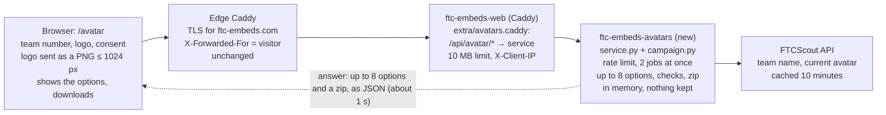
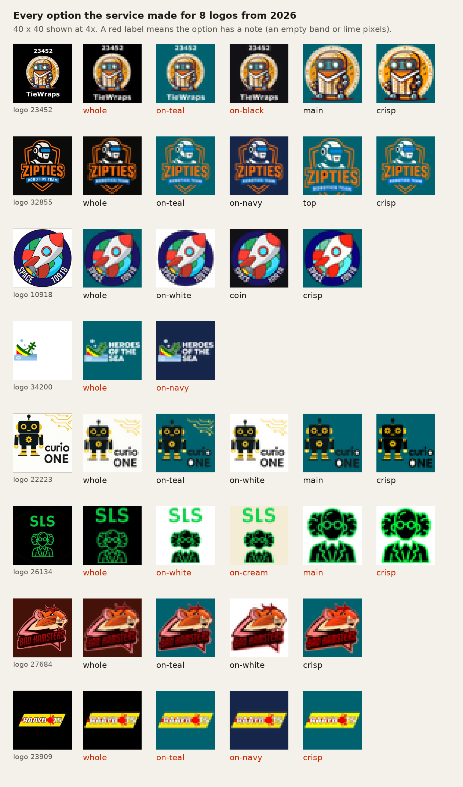
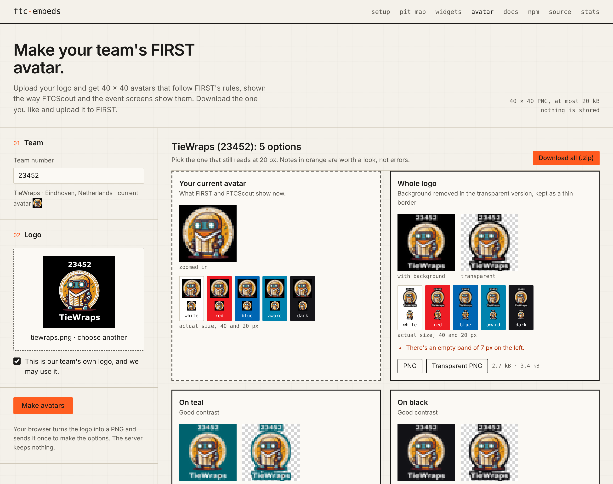
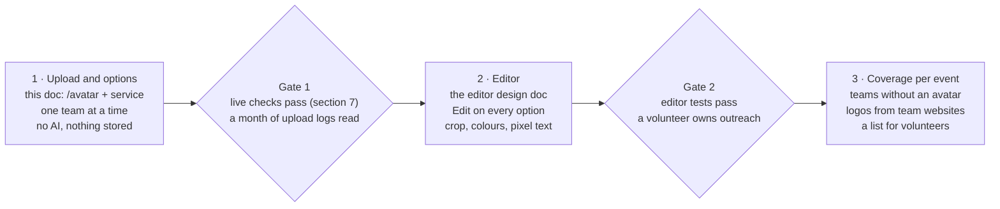

# Automating avatar creation on ftc-embeds.com

Nov 4, 2026 · @Mathijs

## Summary

Phase 1 automates one team at a time. A team member enters the team number and uploads the team's logo, and within a few seconds the server returns up to 8 checked avatar options. No AI API is involved: the server runs the same image steps as the 2026 campaign (`campaign.py` from the ftc-avatar-campaign skill).

- **Flow:** upload, then the server makes the options:
  - the whole logo;
  - the cut-out on the best-contrast colours;
  - the main part only;
  - the top part, cut at the bottom;
  - a coin with a complete ring;
  - crisp colours.

  Each option is checked against FIRST's rules. The page shows them at actual size on FIRST's backgrounds, and the team downloads one, or all of them as a zip.
- **What to expect:** in 2026, 10 of 26 first drafts made with these steps were approved without changes. So roughly 4 in 10 teams get an option they can upload as it is. The rest need the editor (phase 2) or a volunteer.
- **The logo comes from the team.** Nothing is scraped, and the upload form asks the team to confirm it's their own logo.
- **Nothing is kept.** The server processes the upload in memory and returns the PNGs in its answer. It stores no images and sends no email.
- **Small footprint:** one container next to `ftc-embeds-web`. Caddy forwards `/api/avatar/` to it through the existing `import extra/*.caddy` line, so the main Caddyfile doesn't change.
- **Later phases (section 9):** the browser editor, then finding which teams at each event have no avatar.

## What the 2026 campaign taught

The image work automates well. Finding logos does not: 18 of the 26 logos came from Instagram, which a server shouldn't scrape. So in phase 1 the team uploads its own logo, which also settles whether it really is theirs.

| Step | Phase 1 (one team, upload) | Evidence from 2026 | How |
| --- | --- | --- | --- |
| Getting the logo | The team uploads it | 18 from Instagram, 6 from team websites, 1 from Facebook, 1 sent by the team | Upload on `/avatar`; fetching from websites is phase 3 |
| Checking it's the team's own logo | The team confirms it | Two logos looked like other teams' (Frits Philips, Tech Campus) | A required checkbox on the upload form |
| Team name | Automatic | — | FTCScout team card: file names now, initials for a name bar in phase 2 |
| Cut-out, fit, colour, border | Automatic | 10 of 26 first drafts approved as they were | Options 1 to 3 |
| Dropping a separate name line | Automatic | Bad Hamsters, Screw Looose Scientists | "Main part only" option |
| Text inside a badge or ring | Not yet | Space, Knippin' Gears and Dukes ring text | Editor (phase 2); local OCR could find it (section 6) |
| Redrawing hidden or broken parts | Not yet | Raaybots, Kiwi Robotics, the Zipties shield | Editor (phase 2) |
| A background with contrast | Automatic | Tiewraps: orange on orange "not very visible" | Colour options ranked by contrast |
| Complete circles, cut at the bottom | Automatic | Tiewraps coin and head crops | Coin and "top part" options |
| FIRST's file rules | Automatic | 7 transparent files had hidden lime or magenta pixels | Checks on every option |
| Choosing | The team | A reviewer checked every avatar; 16 of 26 first drafts needed changes | Options side by side on the page |
| Zip and comparison sheet | Automatic | 26 team zips | Included in the server's answer |
| Teams without an avatar, per event | Later | 27 of 80 teams had one (34%) | Coverage job (phase 3) |
| Contacting teams | Not automated | Public emails found for 9 of 26 teams | The server sends no email |

## Architecture



The browser sends one request and gets one answer. Between Caddy and the service everything stays on the server's Docker network (`ftcscout-edge`), and the service publishes no port.

- **The page** (`site/avatar.html`, served at `/avatar` by the existing `try_files` rule) does what a browser does well. It checks the team number and the consent box, and draws any image it can display (PNG, JPEG, WebP, GIF, SVG, AVIF) onto a canvas of at most 1024 px, which it sends as a PNG. So the server only ever sees PNGs, SVGs come out sharp, and photo metadata such as GPS never leaves the device.
- **Caddy** (`ftc-embeds-web`) gets one snippet, `extra/avatars.caddy`, through its existing `import extra/*.caddy` line. It sends `/api/avatar/*` to `ftc-embeds-avatars:8080` with a 10 MB body limit, and passes the visitor's address on as `X-Client-IP` (section 7).
- **The service** checks the request and the visitor's rate limit, waits for a free slot (2 jobs at a time), looks the team up on FTCScout, makes the options (section 4) and answers with every PNG and a zip as data URIs: 120 to 470 kB of JSON.
- **Nothing is stored.** The upload stays in memory for about a second. The comparison sheet for the zip is drawn in a temporary folder on a `tmpfs` and deleted before the answer goes out. The service logs one line per request (the team number, the status and the options it made), with no images and no IP addresses.
- **No cost for npm users.** The page and the service are outside the npm package. `files` in `package.json` lists `src`, `dist/*.mjs`, `dist/*.js`, `docs`, `README.md` and `LICENSE`; the page is built into `dist/site/`, which none of these match, and the service lives in `avatar/service/`. Phase 1 adds a guard test that keeps it that way (section 7).

## The options service

`avatar/service/service.py` is a Python standard-library HTTP server (`ThreadingHTTPServer`) that uses `campaign.py`, the ftc-avatar-campaign skill's toolkit, as a library. Both are attached (section 8) and were tested on 32 logo files from 2026. The README next to them documents the API in full.

**Request.** `POST /api/avatar/options?team=<n>` with the image as the raw body. The answer is `{team, name, current, base, flat, options[], zip, ms}`; each option has `id`, `label`, `note`, `bg`, `opaque` and `transparent` (data URIs), `bytes`, `warnings` and `files`. An error is `{"error": "<a sentence the page shows as it is>"}`:

| Status | When |
| --- | --- |
| 400 | No or bad team number (`\d{1,6}`), an empty body, or an image under 16 px |
| 413 | A body over 10 MiB (answered before the body is read; through Caddy, Caddy answers it without JSON), or an image over 25 megapixels to decode (a JPEG is decoded at 1/2, 1/4 or 1/8 size first) |
| 415 | Not an image Pillow can read |
| 429 | More than 10 uploads from one visitor in 10 minutes |
| 503 | Both slots busy for 20 s |
| 500 | A bug; the details go to the log only |

**Steps, per upload:**

1. **Read.** Pillow opens the image and checks its size before decoding, so a 7.8 kB PNG of 8000 × 8000 is refused as a decompression bomb. A JPEG is decoded at 1/2, 1/4 or 1/8 size straight away. The EXIF rotation is applied and the logo is reduced to 768 px. The 40 px result is drawn at 320 px, and 768 px gives results within 1 to 2.5 colour levels (of 255) of 1024 px on average, in about 60% of the time and with half the memory.
2. **Background.** A logo with transparency keeps it. Otherwise the border colour is measured: if at least 60% of the border is within 40 of it, the background is flat and is cut away from the edges inward, with a 2 px band unblended so no halo is left. A logo without a flat background only gets the whole-logo option, with rounded corners.
3. **Main part.** Parts of the cut-out are grouped when their boxes, grown by 2%, overlap, and the group with the biggest box stays. Picking the biggest part by pixel count, as `campaign.py` did, kept Zipties' "ROBOTICS TEAM" banner instead of the helmet.
4. **Options,** in this order, at most 8; near-duplicates (a mean difference of 2 levels or less) are dropped:

| id | When | What |
| --- | --- | --- |
| `whole` | Always | The logo on its own background colour, cut away in the transparent version and kept as a 1.1 px border. An already transparent logo goes on the colour with the most contrast. |
| `on-<colour>` | Flat background | The cut-out on up to two of teal `#00626e`, navy `#16264a`, black `#121216`, white and cream: those with under 35% of its edge pixels within distance 70 of the colour, best first, or else the single best. The colour the whole option already uses is skipped |
| `main` | The main part leaves out 3% of the logo or more | The main part on the best colour |
| `top` | The main part is at least 1.15 × as tall as it is wide | Its top square, cut at the bottom edge with no gap under it |
| `coin` | A round badge: square within 8%, at least 80% of the circle filled | Zoomed in to 92%, inside a complete 1.1 px ring |
| `crisp` | 40 colours or more at 40 px | Contrast and saturation × 1.25, then 14 colours |

5. **Checks** on every option, reported as `warnings` that never hide an option: a file over 20 kB; pixels near lime or magenta (G > 200, R < 120, B < 120, or R > 200, B > 200, G < 80); a logo that uses less than 34 px; an empty band of 5 px or more. Every PNG is a static 40 × 40, the opaque one has no alpha, and the colour under fully transparent pixels is zeroed. `test_service.py` asserts the file rules on every option, and checks the lime and empty-band notes on two made-up logos.
6. **Answer.** Per option an opaque and a transparent PNG, named `<number>-<slug>-<id>-avatar-40.png` and `…-transparent.png`. The zip holds all of them, a comparison sheet (`<base>-options.png`: the options zoomed and at actual size on FIRST's backgrounds) and `HOW-TO-UPLOAD.txt`.



Measured on 2 CPU cores with 32 logo files from 2026 (section 8): 0.6 to 0.7 s per logo (median) and 1.4 s at most. With 8 uploads at once it handles 105 to 115 a minute, answers each within 8 s, and peaks at 640 MB of memory. Each logo got 2 to 5 options, always `whole` and at least one contrast colour.

**What it doesn't do yet.** Text inside a ring (Space, Dukes), redrawing a part that's cut off or covered (Raaybots, Kiwi Robotics) and pixel lettering like the Casimir Tech name bar still need a person: that's the editor in phase 2. A logo that's only text gets the same options, unreadable at 40 px; local OCR could warn about that (section 6).

## The page

`site/avatar.html` (attached, 25 kB with its styles and script) is one self-contained page in the site's own style: the tokens, header, lede, two-column form and footer of `site/team.html`. It needs no build step. `build.mjs` copies it to `dist/site/` and gives its `config.js` a content hash, Caddy serves it at `/avatar`, and it reads `apiBase` from `config.js` for the team lookup.



**01 Team.** A number field. 350 ms after typing stops, the page fetches `<apiBase>/teams/<n>/card` (5 s timeout) and shows the team's name, city and current avatar, so a typo shows up before the upload. If FTCScout answers 404 or has no such team, it says so in orange; any other failure shows nothing, and the upload still works.

**02 Logo.** A file field over a drop zone; pasting an image works too. Every file goes through the browser first:

- Any image the browser can display (PNG, JPEG, WebP, GIF, AVIF, SVG) is drawn onto a canvas of at most 1024 px and sent as a PNG. Browsers apply the EXIF rotation when they draw, and the canvas drops all metadata.
- An SVG first gets an explicit `width` and `height` (1024 px on its longest side, from its `viewBox` when it has no size), so it's drawn sharp instead of at the default 300 × 150. An `` never runs an SVG's scripts.
- A file the browser can't open, such as HEIC in Chrome, is refused on the spot: "Your browser can't open this file. Save the logo as a PNG or JPEG and try again." Files over 40 MB and images under 16 px are refused too.
- The consent box, "This is our team's own logo, and we may use it.", must be ticked before anything is sent.

**Make avatars.** One `fetch` with the PNG as the body and a 90 s timeout. The button is disabled while it runs, and it waits for a logo that's still being read, so it never sends the previous one. Every failure ends in one sentence in the status line:

| Situation | The page says |
| --- | --- |
| The service answered with an error | Its `error` sentence |
| 404, 405, 502, 503 or 504 without JSON (not deployed, or down) | "The avatar maker is offline right now. Try again later." |
| No connection | "Couldn't reach the avatar maker. Check your connection and try again." |
| More than 90 s | "This took too long. Try again in a minute." |
| 413 without JSON (Caddy's size limit) | "This file is too large. Upload a logo under 10 MB." |

**Results.** A title like "TieWraps (23452): 5 options", then a card per option, with the team's current avatar first (dashed) when FTCScout has one. A card shows:

- the label and the note;
- the opaque and the transparent version at 3×, pixelated, the transparent one on a checkerboard;
- the transparent version at 40 and 20 px on white, FIRST red `#ED1C24`, blue `#0066B3`, award `#0083AE` and dark;
- the warnings, in orange;
- download links for both PNGs, with their sizes.

"Download all (.zip)" sits above the cards, and the steps to upload to FIRST below them. Downloads are `blob:` URLs made from the data URIs and freed on the next run; the page stores nothing in the browser either.

**Phone.** One column with the form first; after an answer the page scrolls to the results. The browser test checks for sideways scrolling at iPhone 13 width.

**Accessibility.** Real labels and a fieldset per step, a `role="status"` line for messages, alt text on the zoomed images, the actual-size strips as a labelled group, focus rings in the accent colour, and light and dark from `prefers-color-scheme`.

**Changes to existing pages.** Only two: add `<a href="/avatar">avatar</a>` after "widgets" in the nav of `index.html`, `team.html`, `setup.html` and `pit-map.html`, and add a line under the team widgets: "No avatar yet? Make one."

**Later, in phase 2.** Each option card gets an "Edit" button that opens the editor from the editor design doc with the logo and that option's settings, instead of a blank canvas. The service can then also return the 768 px cut-out (`?layers=1`), so the editor starts from the same cut.

## Optional local tools, no API tokens

Two open-source tools could run next to the service on the same server, with no account or token. Phase 1 needs neither, and neither was tested for this doc; measure them on the test logos first.

|  | Tesseract OCR | rembg (background removal) |
| --- | --- | --- |
| What it would add | Find text in the logo and warn when it will be unreadable at 40 px, such as ring text like Space's and Dukes' | A cut-out for logos without a flat background, such as a photo of a banner or a shirt |
| How | The Debian package `tesseract-ocr` and `pytesseract`; `image_to_data` gives words, boxes and a confidence | `pip install "rembg[cpu]"` (Python 3.11 to 3.13), one session reused across requests, with the model named explicitly |
| Size | A few tens of MB in the image | onnxruntime plus a model: `silueta` is 43 MB. The default, `bria-rmbg`, is about 1 GB and needs a paid licence for commercial use, so don't use the default |
| Licence | Apache 2.0 | rembg is MIT; each model has its own licence |
| Risks | Stylised lettering is often missed or misread, so it can only warn, never remove text | Thin lines and text get cut. Models download on first use, so bake the model into the image: the container's file system is read-only |
| Worth it when | Phase 2, as a warning in the editor | The log marks many uploads `no-flat`, meaning no flat background. All 32 logo files from 2026 had a flat or transparent background |

rembg also offers cloud backends that need an API key; those are out of scope.

**Recommendation:** ship phase 1 without either. The service logs which options each upload got, and `no-flat` when the background wasn't flat (`200 - whole,on-teal,main 640 ms`, no IP address). After a few weeks, if `no-flat` uploads are common, try rembg with `silueta` or `isnet-general-use` on those, as an extra option rather than a replacement. Add Tesseract with the editor in phase 2, as a warning only.

## Deployment

Everything goes on the existing server next to `ftc-embeds-web`, following the pattern of the statistics (`scripts/stats.sh`): files in the repository, and a script that copies them to `/opt/ftc-embeds` and reloads Caddy.

**Repository changes**

| Path | Change |
| --- | --- |
| `avatar/service/` | New: the service, its container, the Caddy snippet, a README and the tests (attached) |
| `site/avatar.html` | New: the page (attached) |
| `scripts/avatars.sh` | New: `install`, `logs` and `remove` (attached) |
| `deploy/docker-compose.yml` | One line: mount `./extra:/etc/caddy/extra:ro` on `web`, so `import extra/*.caddy` finds the snippet without the statistics override. The override mounts the same path, and Compose merges volumes by their path in the container, so the two don't clash |
| `scripts/test.mjs` | A guard test (below): the npm package must contain nothing under `avatar/`, `site/` or `dist/site/` |
| `site/index.html`, `team.html`, `setup.html`, `pit-map.html` | The nav link and one line (section 5) |
| `.gitignore` | `avatar/service/tests/logos/` |

```yaml
services:
    web:
        volumes:
            - ./Caddyfile:/etc/caddy/Caddyfile:ro
            - ./site:/srv:ro
            - ./extra:/etc/caddy/extra:ro
```

**The guard test,** added to `scripts/test.mjs` with `import { execFileSync } from "node:child_process";` at the top. `npm pack` runs the `prepare` build first, even with `--ignore-scripts`, and prints its log before the JSON; the test allows for both. It was checked on a copy of the repository: it passes, and fails once `avatar` is added to `files`.

```js
// The website and the avatar maker (avatar/, site/, dist/site/) must never reach people who install the package.
test("the npm package has none of the website or the avatar maker", () => {
    const out = execFileSync("npm", ["pack", "--dry-run", "--json"], { cwd: root, encoding: "utf8" });
    const files = JSON.parse(out.slice(out.search(/^\[/m)))[0].files.map((f) => f.path);
    assert.ok(files.includes("package.json"), "npm pack listed no files");
    assert.deepEqual(files.filter((p) => /^(avatar|site|dist\/site)\//.test(p)), []);
});
```

**The container** (`avatar/service/docker-compose.yml`, its own Compose project in `/opt/ftc-embeds/avatars`):

- `python:3.13-slim` with `fonts-dejavu-core` for the comparison sheet and the pinned Pillow, numpy and scipy, running as user 10001;
- on the `ftcscout-edge` network as `ftc-embeds-avatars`, with no published port;
- `read_only: true` with a `tmpfs` at `/tmp`, `cap_drop: [ALL]`, `no-new-privileges` and `pids_limit: 64`;
- `cpus: 2` and `mem_limit: 1g` (two jobs at once peaked at 580 MB in the tests);
- a health check on `/api/avatar/health`, and `restart: unless-stopped`.

**The Caddy snippet** (`avatars.caddy`, copied to `/opt/ftc-embeds/extra/`):

```
handle /api/avatar/* {
	request_body {
		max_size 10MiB    # the service's own limit, 10 × 1024 × 1024 bytes
	}
	reverse_proxy ftc-embeds-avatars:8080 {
		header_up X-Client-IP {http.request.header.X-Forwarded-For}
	}
}
```

**The visitor's address.** The rate limit needs it, and `X-Forwarded-For` as the service receives it doesn't give it: unless `trusted_proxies` is set, each Caddy that proxies replaces that header with the address it sees. The edge Caddy sets it to the visitor's address; `ftc-embeds-web` would replace it with the edge's address, so the snippet copies the edge's value into `X-Client-IP` first. The service only reads `X-Client-IP` (the `CLIENT_IP_HEADER` setting), and the snippet overwrites any `X-Client-IP` a visitor sends. If Cloudflare proxies the site, the edge sees Cloudflare's addresses; then use `{http.request.header.CF-Connecting-IP}`, which is only safe when the server accepts connections from Cloudflare alone (open question 1).

**Order of deployment**

1. Commit the changes and run `scripts/deploy.sh`. It runs the tests (the guard test included), uploads the page and the compose file, and recreates `ftc-embeds-web` with the `extra` mount.
2. Run `scripts/avatars.sh install`. It copies `avatar/service/` without the tests to `/opt/ftc-embeds/avatars/`, builds and starts the container, and waits up to 30 s for its health check from inside `ftc-embeds-web`; if it never answers, the script stops with nothing routed to it. Only then does it copy the snippet and reload Caddy. If Caddy refuses the snippet, the script removes it again, so the old config keeps running and the next deploy isn't blocked.
3. Run the acceptance checks below.

To update, run `scripts/avatars.sh install` again; the pip layer stays cached. To take it down, run `scripts/avatars.sh remove`.

**Acceptance checks on the live site.** None of these could be run for this doc: the sandbox has no access to a Docker registry, so the image build and the Caddy snippet are untested.

- `curl -s https://ftc-embeds.com/api/avatar/health` answers `{"ok": true}`.
- `test_service.py` against `https://ftc-embeds.com`, without `--rate` and with at most 5 logos, passes; Caddy answers its 11 MB check with 413. The live rate limit counts the whole run as one visitor, and 5 of its other checks count too, so wait 10 minutes before the next check.
- 11 uploads from one machine within 10 minutes, each with a different made-up `X-Forwarded-For` and `X-Client-IP`, get a 429 on the 11th. If they don't, the visitor's address isn't coming through.
- While that machine is limited, an upload from another network (a phone without Wi-Fi) still works.
- `/avatar` works on a phone, and `scripts/avatars.sh logs` shows one line per upload, without an IP address.
- `npm pack --dry-run` lists no `avatar/` or `site/` files (the guard test checks this on every deploy).

## Attached files

The 13 files come with this doc as `avatar-automation-phase1.zip`, at their paths in the repository: unzip it in the repository root. The zip also holds this doc as `avatar/automation-design.md`, for a coding agent to read.

| File | What it does | Tested |
| --- | --- | --- |
| `avatar/service/service.py` | The HTTP server: request checks, rate limit, options, checks, zip (section 4) | By `test_service.py` and `test_page.py` |
| `avatar/service/campaign.py` | The image steps from the ftc-avatar-campaign skill, with the main part chosen by grouped boxes | Through the service; the 2026 avatars were made with it |
| `avatar/service/requirements.txt` | Pillow 12.3.0, numpy 2.5.3, scipy 1.18.1 | On Python 3.13 |
| `avatar/service/Dockerfile`, `docker-compose.yml` | The container (section 7) | `docker compose config` only: not built |
| `avatar/service/avatars.caddy` | `/api/avatar/*` to the container | Not run |
| `avatar/service/README.md` | API, options, settings, tests and deployment |  |
| `avatar/service/tests/test_service.py` | Every logo in a folder through the API, with FIRST's file rules asserted on every option; then 7 error cases, the notes on two made-up logos, and the rate limit | Passes |
| `avatar/service/tests/test_page.py` | The page in Chromium (Playwright): the form's own errors, an SVG, each logo, the downloads and the zip, a 502, Caddy's 413, the team lookup, and phone width | Passes |
| `avatar/service/tests/testdata/` | `robot.svg` (with only a `viewBox`) and `not-an-image.png` |  |
| `site/avatar.html` | The page (section 5) | By `test_page.py` |
| `scripts/avatars.sh` | `install`, `logs` and `remove` on the server | Against a fake server, with ssh, rsync and docker stubbed |

**Test results,** on 2 CPU cores, with 32 logo files from 2026 (the campaign's 26, Zipties, Tiewraps as PNG and as JPEG, and 3 found but not used) plus a 4000 × 3000 JPEG photo:

- 2 to 5 options per logo, 137 in all: `whole` 33, a contrast colour 63, `crisp` 26, `coin` 6, `main` 5, `top` 4. Every logo had a flat or transparent background.
- Every PNG is a static 40 × 40 of 1.1 to 4.8 kB, against FIRST's limit of 20 kB. 49 options note an empty band, and the 5 options of one logo (Screw Looose Scientists) note pixels near lime.
- 0.6 to 0.7 s per logo (median) and 1.4 s at most. 8 uploads at once: 105 to 115 a minute, the slowest answer in 7.8 s, memory at 640 MB.
- Errors: no team number, letters as the team number, an empty body and a 12 px image get 400; 11 MB gets 413 before the body is sent; text gets 415; an 8000 × 8000 PNG of 7.8 kB gets 413. A lime square and a wide banner get their notes on every option. With `RATE=5`, the 6th upload from one visitor gets 429 while another visitor still gets 200.
- The page: all 17 checks pass with 4 logos (a PNG on black, a transparent PNG, a 4000 × 3000 JPEG and a round badge), with no script errors.
- `scripts/avatars.sh install` against a fake server: it routes traffic only after the health check passes, and takes the snippet back when Caddy refuses it.
- The guard test, on a copy of the repository: it passes, and fails once `avatar` is added to `files`.

**Bugs found by the tests and a review,** worth keeping tests for:

- The main part was the biggest part by pixel count, which for Zipties was the "ROBOTICS TEAM" banner.
- The `top` option took the top 55% and left an empty band of 16 px; it now takes the top square.
- An already transparent logo with white text got its `whole` option on white, where the text vanished (Heroes of the Sea).
- For an already transparent logo, the first `on-<colour>` option repeated the colour `whole` had taken, so one contrast option was lost; it now skips that colour.
- An 8000 × 8000 PNG of 7.8 kB was decoded, because Pillow only refuses images over twice its limit; memory went to 690 MB.
- At 1024 px, two jobs at once peaked at 910 MB of memory; at 768 px, 580 to 640 MB.
- Clicking "Make avatars" while a new logo was still being read sent the previous logo.
- `avatars.sh install` routed traffic before the container answered, and the API test's 11 MB check used plain HTTP for an `https://` address.

To run the tests:

```bash
cd avatar/service
pip install -r requirements.txt playwright
python3 -m playwright install chromium       # the browser for test_page.py
DEV_PAGE=../../site/avatar.html RATE=5 python3 service.py &
python3 tests/test_service.py http://127.0.0.1:8080 tests/logos --rate 5
# restart the service with RATE=1000 for the page test, which uploads every logo it is given
python3 tests/test_page.py http://127.0.0.1:8080 tests/logos/*.png
```

## Rollout



Phase 1 is most of the value for the least work: the code is attached and tested, so what's left is wiring it into the repository and the server.

| Phase | What ships | Effort (estimate) | Needs |
| --- | --- | --- | --- |
| 1. Upload and options | `/avatar` and the options service, as in this doc | 1 to 2 days, mostly deployment and the live checks | Nothing new |
| 2. Editor | An "Edit" button on every option, opening the editor from the editor design doc with that option's settings; `?layers=1` on the service; optionally the Tesseract warning | 1 to 2 weeks | Phase 1 |
| 3. Coverage per event | A nightly job and a page per event: which teams have no avatar (FTCScout's `eventByCode` teams and their `avatar`), each with a link to `/avatar?team=<n>`. Logos fetched only from team websites (FTCScout's `website`, respecting robots.txt), offered as a starting point | 3 to 5 days | Phase 1; `/avatar` reading `?team=` |

Phase 3 won't find most logos by itself: in 2026, team websites gave 6 of the 26 logos and Instagram 18, and a server shouldn't scrape Instagram. Its value is the list of teams to contact, which a volunteer still works through, as in 2026.

## Open questions

1. **Is Cloudflare in front of ftc-embeds.com?** `build.mjs` mentions Cloudflare's cache. If it proxies the site, the visitor's address has to come from `CF-Connecting-IP`, and the server should accept connections from Cloudflare only (section 7).
2. **Is 10 uploads per visitor per 10 minutes right?** A club working on one school network shares one address, so several of its teams count as one visitor.
3. **Is the consent line enough?** "This is our team's own logo, and we may use it." It could also link FIRST's rule against sports-team, company and TV-character logos.
4. **Dutch?** The site is in English, while the 2026 messages to teams were in Dutch.
5. **Count use on `/stats`?** The log already has one line per upload, with no IP address; uploads per week would show whether the page is used.
6. **Where does `campaign.py` live?** The service has its own copy, with the better main-part step. Update the ftc-avatar-campaign skill to match, or make the repository the source for both.
7. **Keep showing the current avatar?** It's public on FTCScout already, and the page shows it next to the options for comparison.
